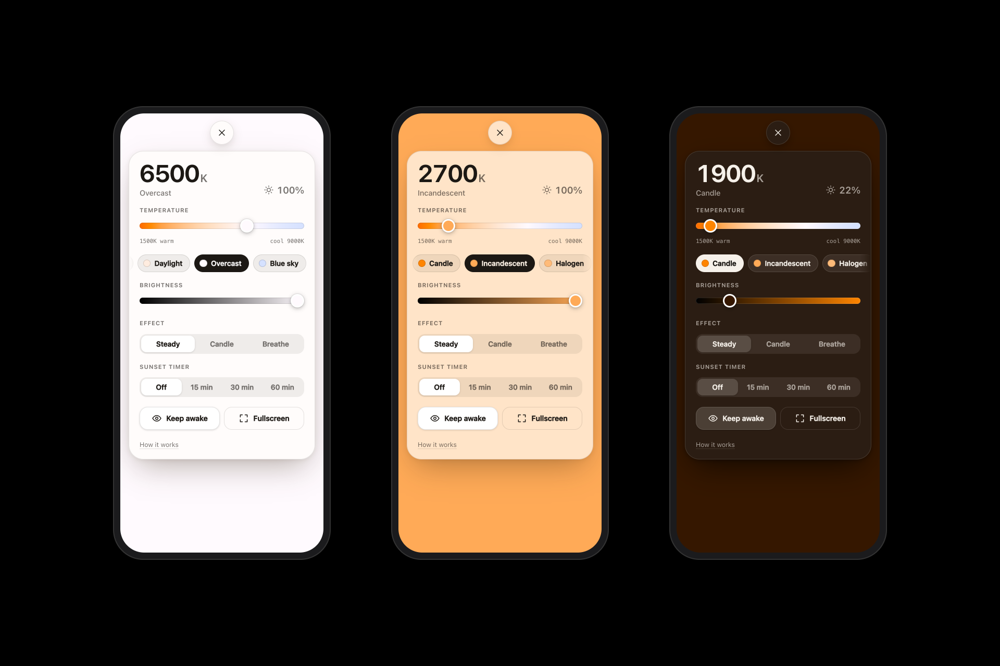

# HueCtl

HueCtl turns your phone (or any screen) into a soft, adjustable light source. Pick a color temperature from a warm **1500K** ember to a crisp **9000K** blue sky, dim it, let it flicker like a candle, or have it fade you to sleep.

It's a single static page with no dependencies and no build step, and it installs as an offline app.

## Features

- **Color temperature, 1500K–9000K.** It uses an improved blackbody fit, so warm tones look like real warm light.
- **Dimmer, 5–100%.** Brightness is scaled in linear light, so the hue stays true and the slider feels even.
- **Presets:** Candle, Incandescent, Halogen, Neutral, Daylight, Overcast and Blue sky.
- **Effects:**
  - *Candle* is a gentle, organic flicker.
  - *Breathe* is a slow 10-second pulse you can pace your breathing to.
  - There are no strobes.
- **Sunset timer (15, 30 or 60 min).** The light slowly warms and fades to black, then lets the phone sleep. Tap to bring it back.
- **Keep awake.** It holds a screen wake lock so the light doesn't switch off mid-use.
- **Fullscreen and immersive mode.** The controls hide after a few seconds idle, and the browser bar takes on the light's color.
- **Readable at any setting.** The controls switch to a dark style when the light is dim.
- **Installable and offline.** Add it to your home screen and it opens like a native app, with no network needed.
- **Remembers your last light.** It's restored on launch with no flash.

## Controls

| Action | Touch | Keyboard / mouse |
| --- | --- | --- |
| Warmer / cooler | Swipe left / right anywhere | ← / → (Shift for bigger steps), Shift + scroll |
| Dimmer / brighter | Swipe down / up anywhere | ↓ / ↑ (Shift for bigger steps), scroll |
| Presets | Chips in the panel | 1–7 |
| Open controls | Tap the light | Space |
| Cycle effect | Panel | E |
| Fullscreen | Double-tap | F |
| Close panel | Tap the light | Esc |

## Links and shortcuts

You can open HueCtl straight into a setting, which is handy for bookmarks or home-screen shortcuts:

```
?k=2700        color temperature in kelvin
?b=60          brightness in percent
?fx=candle     effect: none | candle | breathe
?timer=30      start a sunset timer, in minutes
```

For example, `huectl.vercel.app/?k=2200&b=50&timer=30` gives a warm, dim light that fades out over half an hour. After installing, long-press the app icon for built-in shortcuts: Reading, Candle, Daylight and Sleep.

## Development

No tooling is required. Serve the folder and open it:

```sh
python3 -m http.server 8080
# then open http://localhost:8080
```

Wake Lock and the service worker need a secure context; `localhost` and any HTTPS deploy both qualify. When you add or rename a file, add it to `SHELL` in `sw.js` and bump `VERSION`.

```
index.html             markup + pre-paint boot script
styles.css             all styles (light/dark tone tokens at the top)
js/main.js             rendering loop, input, wiring
js/color.js            kelvin → RGB, brightness, presets
js/store.js            state, persistence, URL params
js/panel.js            control panel
js/gestures.js         swipe/tap handling on the light
js/effects.js          candle + breathe
js/timer.js            sunset timer
js/device.js           wake lock, fullscreen, install prompt
sw.js                  offline cache
manifest.webmanifest   PWA manifest + shortcuts
```

## Screenshots


