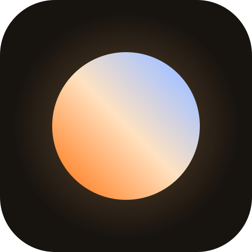

<div align="center">



# HueCtl



<br><br>

<a href="https://huectl.vercel.app"></a>&nbsp;&nbsp;&nbsp;<a href="#lit-in-three-steps"></a>&nbsp;&nbsp;&nbsp;<a href="#run-it-locally"></a>

<sub>Free and open source · runs in any current browser · installs to the home screen and works offline</sub>

</div>

<br>

HueCtl turns the screen in front of you into a softbox. Open the page and the whole screen becomes one even light: any white from the orange of an ember at 1500K to the blue of open sky at 9000K, or any color you turn it to. You run it from a control unit docked at the bottom of the screen, with knobs that turn and keys that travel, built to look and behave like the kit it stands beside. It is a single page with no dependencies, and it keeps working without a network.

<br>

<div align="center">


<br><br><br>

<sub>THE UNIT</sub>

## One control unit, part by part

The controls are one piece of hardware: a glass display, five knurled knobs and thirteen keys. Closed, only the display shows along the bottom edge. Tap it and the rest comes up under it.



</div>

<table>
<tr>
<td width="50%" valign="top">
<b>1 &nbsp; The display</b>
<br>
One reading for each knob. The one in hand is underlined in red. The whole display is the handle: a tap on it opens and closes the unit.
</td>
<td width="50%" valign="top">
<b>2 &nbsp; The status line</b>
<br>
The name of the light, four flags that come on when they apply (FX, AWAKE, LOCK and STBY), and the time left on the sunset timer, written as timecode.
</td>
</tr>
<tr>
<td valign="top">
<b>3 &nbsp; Five knobs</b>
<br>
CCT, INT, TINT, HUE and SAT. Each has a scale of eleven marks over 270 degrees, an index line that shows where it points, and a stop at either end.
</td>
<td valign="top">
<b>4 &nbsp; Seven preset keys</b>
<br>
Whites from Candle at 1900K to Blue sky at 9000K, numbered as they are on a keyboard. The lamp of the one in use is lit.
</td>
</tr>
<tr>
<td valign="top">
<b>5 &nbsp; Function keys</b>
<br>
FX steps through Candle and Breathe. TIMER starts a sunset of 15, 30 or 60 minutes. AWAKE keeps the screen on, FULL fills it, and LOCK freezes the light as it is.
</td>
<td valign="top">
<b>6 &nbsp; PWR</b>
<br>
The one red key. It puts the light out between takes and brings it back exactly as it was.
</td>
</tr>
</table>

<br><br>

<div align="center">

<sub>IN THE HAND</sub>

## Made to be touched, and not by accident

A screen used as a light gets picked up, propped against things and nudged into place. The unit is built around that.

</div>

<table>
<tr>
<td width="50%" valign="top">
<b>Touching the light opens nothing</b>
<br>
A tap on the light never brings up a menu. It closes the unit if it is open, and that is all. Only the display opens it.
</td>
<td width="50%" valign="top">
<b>Knobs turn</b>
<br>
Put a finger on a knob and go round it. Go round wide of it and the same sweep of the hand is a finer adjustment, as it is with a longer lever.
</td>
</tr>
<tr>
<td valign="top">
<b>Keys travel</b>
<br>
A key goes down onto its own shadow when you press it, and its lamp tells you what it did. On a phone that can vibrate there is a tick under the finger for every key, and for the steps of a knob as it turns.
</td>
<td valign="top">
<b>LOCK means locked</b>
<br>
With LOCK lit, the knobs, the presets, FX, TIMER and PWR are dead, swipes do nothing, and neither do the keys that change the light. Nothing moves it until LOCK is pressed again.
</td>
</tr>
<tr>
<td valign="top">
<b>Out of sight, out of reach</b>
<br>
Left alone for four seconds, a closed unit slides off the screen and leaves nothing but light. The next touch brings back the display and does nothing else.
</td>
<td valign="top">
<b>The two you use most need no unit</b>
<br>
Swipe sideways on the light for temperature, up or down for brightness. The display follows your finger and underlines what you are changing.
</td>
</tr>
</table>

<br><br>

<div align="center">

<sub>THE LIGHT</sub>

## What each knob does



<sub>Every strip is drawn by the app's own color code, from one end stop of the knob to the other.</sub>

</div>

<table>
<tr>
<td width="50%" valign="top">
<b>CCT, in kelvin</b>
<br>
From 1500K to 9000K in steps of 50K. Each step is the color of a blackbody at that temperature, from a fit that stays close to the measured curve in the warm range.
</td>
<td width="50%" valign="top">
<b>INT, without a color shift</b>
<br>
Brightness is scaled in linear light, so 3200K is the same tungsten at 20% as at 100%, and the knob feels even from one stop to the other.
</td>
</tr>
<tr>
<td valign="top">
<b>TINT, toward green or magenta</b>
<br>
For matching lamps that sit a little off the curve. A screen at full drive has no light left to add, so each direction takes its opposite away instead.
</td>
<td valign="top">
<b>HUE and SAT, for color</b>
<br>
With SAT at zero the light is the white the first three knobs set. Turn it up and that white is carried toward the hue, mixed in linear light, all the way to a pure color.
</td>
</tr>
<tr>
<td valign="top">
<b>Edge to edge, and it stays on</b>
<br>
The page is one flat color with nothing drawn on it, and the browser's bar takes that color where the browser allows it. AWAKE holds the screen on through the wake lock and is on from the start.
</td>
<td valign="top">
<b>It comes back as you left it</b>
<br>
The last light is kept on the device and painted before anything else loads, so reopening HueCtl never flashes another color at your subject.
</td>
</tr>
</table>

<br><br>

<div align="center">

<sub>IN USE</sub>

## What a screen can light

A screen is a small, soft source. It will not light a room. Within arm's reach it does real work.

</div>

<table>
<tr>
<td width="50%" valign="top">
<b>A face on a call</b>
<br>
A second screen beside the camera, somewhere between 4000K and 5600K, fills the shadows an overhead lamp leaves.
</td>
<td width="50%" valign="top">
<b>Something small on a table</b>
<br>
A tablet a hand's width from a watch, a plate or a keycap gives the broad, soft highlight a small softbox would.
</td>
</tr>
<tr>
<td valign="top">
<b>Matching the room</b>
<br>
Set the screen to the lamps that are already on, 2700K for household bulbs or 3200K for tungsten, trim it with TINT, and the fill stops showing as a second color.
</td>
<td valign="top">
<b>A wash of color</b>
<br>
Turn SAT up and the same screen is a colored accent: a blue rim on a product, a red kick on a face, at whatever strength INT gives it.
</td>
</tr>
</table>

<br><br>

<div align="center">

<sub>CONTROLS</sub>

## Fingers, keys or a wheel

| | Touch | Keyboard and mouse |
| :-- | :-- | :-- |
| Warmer or cooler | Swipe left or right on the light, or the CCT knob | <kbd>←</kbd> <kbd>→</kbd>, or <kbd>Shift</kbd> and scroll |
| Dimmer or brighter | Swipe down or up on the light, or the INT knob | <kbd>↓</kbd> <kbd>↑</kbd>, or scroll |
| Tint, hue and saturation | Their knobs | <kbd>Tab</kbd> to a knob, then the arrow keys |
| Presets | Keys 1 to 7 on the unit | <kbd>1</kbd> to <kbd>7</kbd> |
| Open or close the unit | Tap the display | <kbd>Space</kbd>, and <kbd>Esc</kbd> to close |
| Next effect | FX | <kbd>E</kbd> |
| Lock and unlock | LOCK | <kbd>L</kbd> |
| Light off and on | PWR | <kbd>P</kbd> |
| Fullscreen | FULL, or double-tap the light | <kbd>F</kbd> |

</div>

Hold <kbd>Shift</kbd> with an arrow key for bigger steps. Every knob is a native slider underneath, so a keyboard and a screen reader work it like any other.

<br><br>

<div align="center">

<sub>SHORTCUTS</sub>

## Open straight into a light

Put the light in the address, and a bookmark or a home screen icon opens into it.

| | |
| :-- | :-- |
| `?k=3200` | Color temperature, in kelvin |
| `?b=60` | Brightness, in percent |
| `?tint=-10` | Tint, from `-100` (green) to `100` (magenta) |
| `?h=210&s=80` | Hue in degrees and saturation in percent |
| `?fx=candle` | Effect: `none`, `candle` or `breathe` |
| `?timer=30` | Start a sunset timer, in minutes |

</div>

`huectl.vercel.app/?k=3200&b=60` is a dim tungsten fill, and `huectl.vercel.app/?h=210&s=100&b=40` is a low blue wash. On Android and on a computer, the installed app's icon also offers four lights of its own: Reading, Candle, Daylight and Fall asleep.

<br><br>

<div align="center">

<sub>PRIVACY</sub>

## Nothing leaves the device but light

</div>

<table>
<tr>
<td width="50%" valign="top">
<b>Nothing is sent</b>
<br>
The only thing HueCtl asks the network for is its own files. There are no analytics, no fonts or scripts from anywhere else, and no account.
</td>
<td width="50%" valign="top">
<b>Two things are kept</b>
<br>
Your last light, and whether you have seen the first hint. Both stay in the browser's storage on the device, and clearing the site's data removes them.
</td>
</tr>
<tr>
<td valign="top">
<b>No permissions</b>
<br>
It never asks for the camera, the microphone, your location or notifications. Keeping the screen on and going fullscreen need no prompt.
</td>
<td valign="top">
<b>Short enough to read</b>
<br>
The whole app is about 1,150 lines of JavaScript in nine modules in <a href="js"><code>js</code></a>, with no third-party code.
</td>
</tr>
</table>

<br><br>

<div align="center">

<sub>UNDER THE HOOD</sub>

## One page, nothing to build

</div>

HueCtl is plain HTML, CSS and JavaScript modules, written against the browser with no framework, no bundler and no package to install. The light is the page's background, set through one custom property. The unit is drawn in CSS alone: the knurling, the screws and the lamps are gradients and the scales a few lines of inline SVG, with no image files behind them. While no effect is running, the page does nothing between your inputs: no animation frame, no interval.

<table>
<tr><td><b>Dependencies</b></td><td>None</td></tr>
<tr><td><b>Build step</b></td><td>None. The files in this repository are the files the browser runs</td></tr>
<tr><td><b>Size</b></td><td>60 kB of code in 13 files, 22 kB gzipped</td></tr>
<tr><td><b>Tests</b></td><td>10 unit tests, and 61 checks in a real Chrome worked by touch, mouse and keyboard. CI runs both on every push</td></tr>
<tr><td><b>Offline</b></td><td>A service worker caches the app on the first visit. Every launch after that opens from the cache at once and fetches any new version in the background for the next one</td></tr>
<tr><td><b>Effects</b></td><td>Candle is four slow sine waves that never line up, the fastest at 2.3 Hz. Breathe is one pulse every ten seconds. There are no strobes</td></tr>
<tr><td><b>Reduced motion</b></td><td>The unit stops animating and the candle wavers half as much. The light itself still fades and breathes, because that is the content</td></tr>
</table>

<br><br>

<div align="center">

<sub>GETTING STARTED</sub>

## Lit in three steps

</div>

<table>
<tr>
<td width="33%" valign="top">
<b>1 &nbsp; Open it</b>
<br>
Go to <a href="https://huectl.vercel.app">huectl.vercel.app</a> on the screen you want to use as the light.
</td>
<td width="33%" valign="top">
<b>2 &nbsp; Turn the screen all the way up</b>
<br>
HueCtl sets the color. The device decides how much light there is, so raise its own brightness to the top and switch off auto-brightness.
</td>
<td width="33%" valign="top">
<b>3 &nbsp; Keep it</b>
<br>
Add it to the home screen. It then opens without the browser around it, and without a network.
</td>
</tr>
</table>

> [!NOTE]
> **Adding it to the home screen.** On an iPhone or iPad, open the Share menu in Safari and choose **Add to Home Screen**. On Android, and in Chrome or Edge on a computer, the unit shows **Install app** when the browser offers it, and the browser's own menu has the same command.

<br><br>

<div align="center">

<sub>QUESTIONS</sub>

## Good to know

</div>

<details>
<summary><b>Why does tapping the light do nothing?</b></summary>
<br>
On purpose. A screen that is being used as a light is touched all the time, and a menu that opens under a stray thumb covers the light with controls. Tap the display at the bottom edge instead. If the unit has slid away, the first touch anywhere brings the display back.
<br><br>
</details>

<details>
<summary><b>How do I turn a knob with a mouse, or without one?</b></summary>
<br>
With a mouse, press on the knob and carry the pointer round it, the same as a finger. From the keyboard, <kbd>Tab</kbd> to the knob and use the arrow keys. The arrow keys and <kbd>1</kbd> to <kbd>7</kbd> also work with nothing selected, for temperature, brightness and the presets.
<br><br>
</details>

<details>
<summary><b>How bright is it?</b></summary>
<br>
As bright as your screen, and no brighter. HueCtl chooses the color and the level within what the display can do, so turn the device's own brightness to the top first. A phone or a laptop lights what is within arm's reach of it.
<br><br>
</details>

<details>
<summary><b>Is 5600K really 5600K?</b></summary>
<br>
Close, not calibrated. HueCtl computes the color of a blackbody at each temperature for a standard display, so 5600K reads as daylight and 3200K as tungsten, but every panel is a little different and none of them is a measured light source. For color-critical work, set a custom white balance on the camera from the screen itself, and use TINT to take out a green or magenta cast.
<br><br>
</details>

<details>
<summary><b>The light looks warmer than the number says</b></summary>
<br>
Something else is tinting the screen. Night Shift and True Tone on Apple devices, Night Light on Android and Windows, and apps of the same kind all shift the display's white on top of whatever a page shows. Switch them off while you use the screen as a light.
<br><br>
</details>

<details>
<summary><b>The screen still dims or locks</b></summary>
<br>
AWAKE uses the browser's Screen Wake Lock. Its flag on the display is green while the lock is held. Where a browser does not have one, the key is not shown and the device's own auto-lock setting applies. Some devices also let go of the lock when they run low on battery. The lock is always released while the page is in the background, and taken back when you return.
<br><br>
</details>

<details>
<summary><b>There is no tick under my finger</b></summary>
<br>
The tick is the phone's vibration motor, and a page can only use it where the browser allows. Browsers on Android do. Browsers on the iPhone and iPad do not, so there the knobs and keys work the same in silence.
<br><br>
</details>

<details>
<summary><b>iPhone: there is no FULL key</b></summary>
<br>
Browsers on the iPhone do not let a page go fullscreen, so the key is not shown there. Add HueCtl to the Home Screen and it opens without the browser's bars.
<br><br>
</details>

<details>
<summary><b>What does the sunset timer do?</b></summary>
<br>
Over 15, 30 or 60 minutes it eases the light warmer, down to 1800K, and dimmer, down to black. The display counts the time left as timecode. At the end the screen is black and HueCtl stops holding it awake, so the device can lock. A tap or any key brings your light back as it was.
<br><br>
</details>

<details>
<summary><b>Does it flash?</b></summary>
<br>
No. Candle is a soft waver, never faster than 2.3 Hz and never more than 12% above or below the brightness you set, and Breathe is one slow pulse every ten seconds. There is no strobe and there will not be one.
<br><br>
</details>

<details>
<summary><b>Does it work without a network?</b></summary>
<br>
Yes, after the first visit, in the browser and from the home screen alike. It also updates itself: when there is a network, each launch fetches the current version in the background and the next launch uses it.
<br><br>
</details>

<details>
<summary><b>Which browsers does it run in?</b></summary>
<br>
Any current one. Every push is tested end to end in Chrome, by touch, mouse and keyboard. This version has also been run through Firefox and through WebKit, the engine behind Safari, on a Mac. It has not been tried on an iPhone itself yet, so reports from one are welcome. What a browser lacks is left out piece by piece: without a wake lock or fullscreen their keys are not shown, and everything else works.
<br><br>
</details>

<br><br>

## Run it locally

There is nothing to install. Serve the folder and open it:

```sh
git clone https://github.com/Walid-Idrissi-Labs/HueCtl.git
cd HueCtl
python3 -m http.server 8080
```

Then open `http://localhost:8080`. Any static file server does the same. The wake lock and the service worker need a secure context, which `localhost` and every HTTPS address are.

`node --test` runs the unit tests, and [`node tests/e2e.mjs`](tests/e2e.mjs) works the app in a real Chrome by touch, mouse and keyboard. Both need Node 22 or later and nothing else. `node scripts/readme-art.mjs` redraws the artwork on this page, and [DISTRIBUTION.md](DISTRIBUTION.md) describes how a release is made and how it reaches people.

<table>
<tr><td><a href="index.html"><code>index.html</code></a></td><td>The unit's markup, and the few lines that paint the last light before anything else loads</td></tr>
<tr><td><a href="styles.css"><code>styles.css</code></a></td><td>The light, and the unit: its display, knobs, keys and screws</td></tr>
<tr><td><a href="js/color.js"><code>js/color.js</code></a></td><td>The color of a light from its five settings, and the presets</td></tr>
<tr><td><a href="js/main.js"><code>js/main.js</code></a></td><td>Rendering, input and the wiring between the rest</td></tr>
<tr><td><a href="js/panel.js"><code>js/panel.js</code></a>, <a href="js/gestures.js"><code>gestures.js</code></a>, <a href="js/motion.js"><code>motion.js</code></a></td><td>The unit, swipes and taps on the light, and the glide to a preset</td></tr>
<tr><td><a href="js/effects.js"><code>js/effects.js</code></a>, <a href="js/timer.js"><code>timer.js</code></a></td><td>Candle and Breathe, and the sunset timer</td></tr>
<tr><td><a href="js/store.js"><code>js/store.js</code></a>, <a href="js/device.js"><code>device.js</code></a></td><td>State, storage and the address shortcuts; wake lock, fullscreen and install</td></tr>
<tr><td><a href="sw.js"><code>sw.js</code></a>, <a href="manifest.webmanifest"><code>manifest.webmanifest</code></a></td><td>The offline cache, and the installed app with its shortcuts</td></tr>
<tr><td><a href="tests"><code>tests</code></a></td><td>The unit tests, the end-to-end test and the small Chrome driver it runs on</td></tr>
</table>

## Credits and license

HueCtl is free software under the [GNU General Public License, version 3](LICENSE). Copyright © 2026 Walid Idrissi.

The color of each temperature comes from [Neil Bartlett's fit](https://github.com/neilbartlett/color-temperature) to the blackbody data Tanner Helland published with his original algorithm.

The display takes its manners from the status rows of cinema cameras, RED's above all: the reading in hand underlined in red, the flags, the timecode. HueCtl is not affiliated with RED Digital Cinema.

<br>

<div align="center">


**Now light something.**

<a href="https://huectl.vercel.app"></a>

</div>
